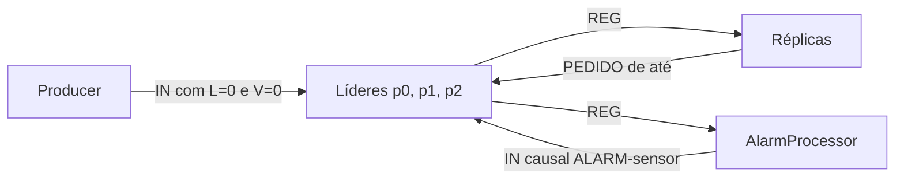

# E1-COMINDIR03 — relógios causais e alarmes

[Ficha #16](https://github.com/cunhaestgv/SD-2026-2027/issues/16). Validação final de 2026-10-24T21:19:57.947100+01:00.

## Condições e âmbito

Os quatro projetos compilam com `--release 11`, usando JDK 25.0.2 em Windows. A API Kubo real em `127.0.0.1:5001` estava indisponível e `ipfs` não estava no PATH; os ensaios usaram uma API HTTP PubSub simulada localmente. Producer, líderes, réplicas, AlarmProcessor, verificadores e recuperação TCP foram executados pelas CLIs Java reais. Os resultados não medem desempenho do Kubo nem de máquinas remotas.

As medições abaixo pertencem apenas à validação final. As ilustrações HTML e o atalho da COMINDIR02 foram conservados como documentação do particionamento e da recuperação herdados; as medições anteriores continuam em [COMINDIR02](../E1-COMINDIR02/RELATORIO.md).

## Arquitetura e execução



N=3. A atribuição preservada é R1: p0/p1; R2: p1/p2; R3: p2/p0, com duas cópias por partição. A ordem de arranque foi réplicas, líderes, processador e produtor. Cada processo usou uma pasta própria para os seus dados.

Compilação em cada projeto:

```powershell
javac --release 11 -encoding UTF-8 -d out src/rep03/*.java
```

CLIs, com os respetivos `out` no classpath:

| Programa | Argumentos |
| --- | --- |
| PartitionReplica | `1 0,1`; `2 1,2`; `3 2,0`; porto da API opcional |
| PartitionLeader | `<k> 3 [endereço] [api]`, para k=0,1,2 |
| AlarmProcessor | `3 [api]` |
| Producer | `3 [api]` |
| PartitionCheck / CausalCheck | `3 <pasta-dos-ficheiros>` |

A API real predefinida é `http://127.0.0.1:5001/api/v0`. Os diretórios `out`, classes e testes internos não fazem parte do commit.

## Relógios e persistência

Os eventos numerados são as atribuições feitas pelos líderes. Para cada IN válido, o líder calcula `L=max(L,Lrecebido)+1`, faz o máximo componente a componente de V e incrementa apenas V[k]. Atribuição de seq, verificação `V[k]==seq` e append usam a mesma secção `synchronized(file)`. O estado só é confirmado após o append; REG é publicado depois, fora do monitor.

`VectorClock` usa `increment(k)` para o evento local, cópias defensivas e texto sem espaços, como `0,1,1`. A comparação vetorial fica em CausalCheck e o parsing nas classes que já interpretam mensagens/registos, conforme a organização validada nas etapas anteriores.

Os formatos são:

```text
IN;sensor;temperatura;L;V
REG;endereço;porto;seq;sensor;temperatura;instante;L;V
seq;sensor;temperatura;instante;L;V
```

Os tópicos são `rep03-in-p<k>` e `rep03-p<k>`. SensorRecord conserva uma cópia do vetor e devolve outra no getter. As réplicas guardam os carimbos do líder, sem incremento ou merge.

## AlarmProcessor e causalidade observada

O processador mantém um único L/V partilhado entre N threads de subscrição. Para cada REG novo aceite, incluindo leituras abaixo do limiar, atualiza máximos. Registos ALARM-* e duplicados pela chave (partição, seq) são ignorados. Temperatura >=28.0 origina ALARM-sensor, encaminhado por `Partitioner.of(alarmSensor)`.

O processador não cria eventos numerados: envia o conhecimento acumulado, sem incrementar L ou V e sem adicionar uma componente. O monitor comum protege deduplicação, merge e cópia dos carimbos. A rede usa o snapshot fora desse monitor. O limiar fica em `Wire.LIMIAR_ALARME`, idêntico nos quatro projetos.

Exemplo real do ensaio integrado:

| Etapa | Sensor | Partição/seq | L | V |
| --- | --- | --- | ---: | --- |
| Evento origem | S02 | p1 / 1 | 1 | 0,1,0 |
| Evento destino | ALARM-S02 | p2 / 1 | 2 | 0,1,1 |

```text
IN;ALARM-S02;29.3;1;0,1,0
```

Assim, `(0,1,0)<(0,1,1)` demonstra p1#1 -> p2#1, com L=1<2. O REG de ALARM-S02 não originou outro alarme.

Também foram enviadas S01=21.0 e S04=22.5. Na reprodução da figura da ficha houve quatro eventos, um par causal e quatro concorrentes **entre partições diferentes**. O par p0#1, V=(1,0,0), L=1 e p2#1, V=(0,1,1), L=2 é concorrente: os vetores são incomparáveis, apesar de L ser diferente.

Em geral, Va<Vb exige todas as componentes <= e pelo menos uma <. Para vetores incomparáveis há concorrência. A causalidade implica crescimento de Lamport; L(a)<L(b), por si só, não comprova causalidade. Ordenar por (L,k) desempata pelo número da partição e não atribui significado causal aos desempates.

## Recuperação TCP e reinício

Foi descartada apenas a entrega de p0#3 à R3 no simulador. Com dez retidos ainda não houve pedido; o décimo primeiro desencadeou `PEDIDO 3 3`. A réplica obteve um registo numa ligação e convergiu para as 14 linhas do líder p0, mantendo os carimbos. Um pedido direto devolveu a mesma linha e FIM; PEDIDO 0 1 recebeu ERRO intervalo inválido.

Linha recuperada:

```text
3;S01;21.0;2026-10-24T21:09:03;3;3,0,0
```

O protocolo PEDIDO/registos/FIM foi preservado. RecoveryServer continua serial na thread principal, usando o mesmo RecordFile e LongSupplier de last. T_TCP_MS continua a ser 5000 ms.

O líder p2 foi parado e reiniciado com o seu ficheiro preservado. RecordFile.last() repôs last/L/V:

| Momento | seq | L | V |
| --- | ---: | ---: | --- |
| Antes | 1 | 2 | 0,1,1 |
| Nova leitura após reinício | 2 | 3 | 0,1,2 |

A nova leitura preservou conhecimento de p1 e continuou com V[2]==seq.

## Verificadores sobre o ensaio final

As cópias finais estão em [evidencias/ensaio-final](evidencias/ensaio-final). Foram reunidas depois de parar as escritas. O produtor publicou 16 leituras com L=0/V=0,0,0 e foi gerado 1 alarme; ficaram 17 eventos nos líderes, distribuídos por [14, 1, 2].

| Verificação | Resultado |
| --- | --- |
| [PartitionCheck](evidencias/ensaio-final/PartitionCheck.log) | Código 0; seis campos, sequências contínuas, partições e duas réplicas iguais por partição; V[k]==seq |
| [CausalCheck](evidencias/ensaio-final/CausalCheck.log) | Código 0; eventos=17, paresCausais=2, paresConcorrentes=42, errosLamport=0 |
| Concorrentes com L distinto | 39/42 (92.86%) |
| [Vista Lamport](evidencias/ensaio-final/vista-lamport.txt) | Todos os eventos por (L,k), com origem p<k> e seis campos do registo |

Nenhum verificador alterou os ficheiros de entrada. CausalCheck gerou apenas a vista ordenada.

## Rajadas da ficha: 300 leituras, 10 sensores

Uma execução sem processador e três com processador, cada uma com pastas vazias e todos os processos reiniciados. Todas terminaram com PartitionCheck=0 e zero erros Lamport. Os valores individuais estão em [MEDICOES.csv](evidencias/MEDICOES.csv).

| Execução | p0/p1/p2 | Alarmes | Pares causais | Concorrentes | Concorrentes com L distinto |
| --- | --- | ---: | ---: | ---: | ---: |
| rajada-sem-processador | 135/69/96 | 0 | 0 | 28899 | 28665 (99.19%) |
| rajada-com-processador-1 | 130/105/95 | 30 | 30726 | 5249 | 4998 (95.22%) |
| rajada-com-processador-2 | 128/114/93 | 35 | 31479 | 5619 | 5363 (95.44%) |
| rajada-com-processador-3 | 145/97/97 | 39 | 32433 | 5106 | 4854 (95.06%) |

Médias aritméticas das três execuções com processador:

| Métrica | Média |
| --- | ---: |
| Registos p0 / p1 / p2 | 134.33 / 105.33 / 95.00 |
| Alarmes | 34.67 |
| Pares causais | 31546.00 |
| Pares concorrentes | 5324.67 |
| Proporção de concorrentes com L distinto | 95.24% |
| Payload REG sem carimbos | 64.28 bytes |
| Payload REG com carimbos | 76.24 bytes |

Os bytes são medidos em UTF-8 sobre o payload de cada REG. A comparação sem carimbos retira os dois últimos campos das mesmas mensagens; não é uma medição da rede da COMINDIR02. Exclui tópicos, HTTP, multipart e TCP/IP.

## Ordem de aplicação nas réplicas

No simulador, atrasou-se apenas o REG de S01 em p0 para R1, deixando o processador recebê-lo. R1 escreveu o alarme em p1 antes da origem em p0; só depois se libertou a entrega atrasada. Os ficheiros não foram adulterados e convergiram no fim.

| Escrita em R1 | Instante ms |
| --- | ---: |
| p1 seq=1 | 1792872893099 |
| p0 seq=1 | 1792872893123 |

Este ensaio força uma ordem de entrega permitida pela ausência de entrega causal entre partições; não mede a sua frequência no Kubo. A réplica mantém ordenação por seq de cada partição.

## Falhas deliberadas em cópias isoladas

O código entregue não foi alterado para estes ensaios. As variantes e compilações temporárias foram eliminadas após a validação.

| Falha | Manifestação medida | CausalCheck |
| --- | --- | --- |
| lider-sem-merge | O alarme perdeu a componente da origem; 0 pares causais e 1 par concorrente | Código 0 |
| lider-L-sem-recebido | Causalidade vetorial com Lamport sem crescer: errosLamport=1 | Código 1 |
| reinicio-a-zero | Arranque recusado pela verificação V[k]==last; histórico permaneceu intacto | Código 0 |
| processador-sem-copy | Agendamento controlado por latch produziu `IN;ALARM-S02;29.3;1;20,1,0`; errosLamport=19 | Código 1 |
| produtor-N4 | Entrada `IN;S01;21.0;0;0,0,0,0` rejeitada pela dimensão; N=3 voltou a ser aceite | Código 0 |


Um código 0 não demonstra a entrega de todas as leituras: o verificador não recupera dependências retiradas dos vetores, não vê mensagens rejeitadas antes de persistir e não acusa uma falha de arranque que não modificou o histórico.

## Checklist técnica da ficha #16

| Requisito | Estado | Evidência |
| --- | --- | --- |
| Quatro projetos, pacote rep03 e classes partilhadas copiadas | OK | rep03-produtor, rep03-lider, rep03-replica, rep03-processador |
| VectorClock: vetor N, máximo, evento local, cópia e texto | OK | Quatro cópias idênticas; API increment(k), comparação em CausalCheck e parsing nos consumidores |
| SensorRecord com seq/sensor/temperatura/instante/L/V | OK | Dados finais de seis campos e cópias defensivas |
| IN, REG e tópicos rep03-* | OK | Publicações reais das CLIs no ensaio |
| Producer com L=0 e vetor zero | OK | 16 publicações iniciais verificadas |
| Líder: Lamport, merge/incremento, seq e append no mesmo monitor | OK | PartitionLeader.acceptReading; invariável verificada nos ficheiros |
| EVENTO e V[k]==seq | OK | Logs dos líderes e ambos os verificadores |
| Reinício a partir de RecordFile.last() | OK | p2 retomou seq/L/V, preservando a componente de p1 |
| Réplicas preservam carimbos e ordenação local | OK | Dois ficheiros iguais por partição; recuperação TCP |
| Recuperação PEDIDO, linhas e FIM sem mudar protocolo | OK | PEDIDO 3 3 e igualdade do registo recuperado |
| PartitionCheck adaptado | OK | Código 0 |
| CausalCheck: causalidade, concorrência, Lamport, proporção e vista | OK | Código 0 em dados válidos e deteção das falhas indicadas |
| AlarmProcessor: uma thread por partição, máximo partilhado e snapshot | OK | N=3 no ensaio integrado; lógica protegida por monitor |
| Temperatura >=28.0 e ALARM-* sem ciclos | OK | Wire.LIMIAR_ALARME=28.0 nos quatro projetos; um alarme no cenário mínimo |
| Destino Partitioner e propagação para outra partição | OK | S02 p1 -> ALARM-S02 p2 |
| Figura, rajada sem alarmes e três rajadas com alarmes | OK | Medições finais registadas neste relatório |
| Reinício de p2 e ordem de escrita em R1 | OK | Ensaios finais anteriores |
| Cinco falhas deliberadas e comparação de bytes | OK | Tabela de falhas e MEDICOES.csv |
| Limites de âmbito preservados | OK | Sem entrega causal, eleição, consenso ou alteração dinâmica de N |

## Limitações e apresentação

- O vetor tem dimensão fixa N. Alterar N exige tratar os históricos; essa migração não foi implementada.
- Perdas entre produtor e líder continuam sem recuperação automática; relógios zero do produtor não identificam leituras perdidas.
- A recuperação TCP é serial e exige mais de dez retidos e tráfego posterior. Uma cauda perdida pode permanecer por recuperar.
- PubSub e TCP dependem de conectividade adequada. Não há autenticação/autorização nem eleição/failover automático de líder.
- As réplicas não impõem entrega causal entre partições. L ordena eventos concorrentes sem demonstrar uma causa.
- Estes ensaios locais com API simulada não validam uma rede IPFS real, NAT, firewall ou execução entre máquinas.

As evidências técnicas dos CA1–CA4 estão reunidas; a avaliação exige ainda a justificação pelo estudante. A explicação oral dos fundamentos, da sincronização, da leitura das medições e dos limites não é certificada pelos códigos de saída dos programas.
